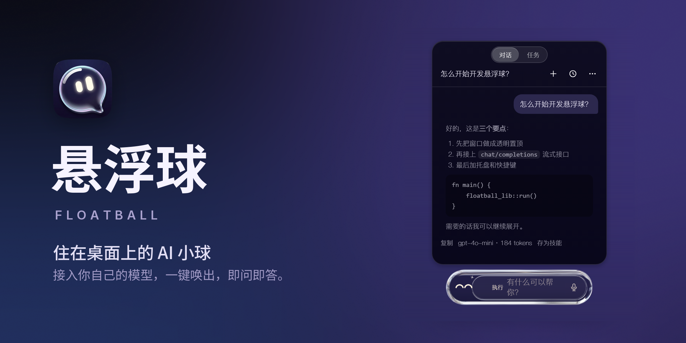
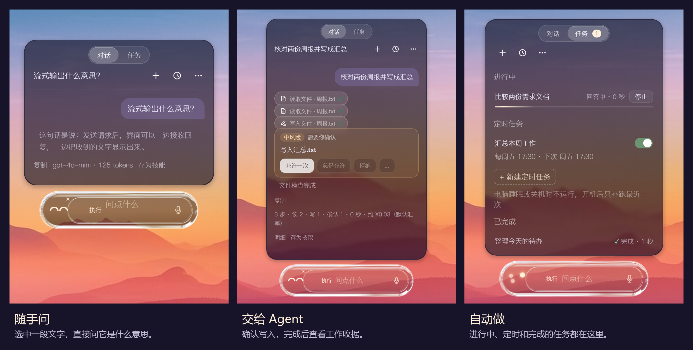

 

**一颗住在桌面上的玻璃小球。接入你自己的模型，设置和对话记录保存在本机。**

 

## [下载最新版](../../releases)

[能做什么](#能做什么) · [安装](#安装) · [接入模型](#接入模型) · [快捷键](#快捷键) · [隐私与数据](#隐私与数据) · [开发](docs/DEVELOPMENT.md)

 

## 为什么是一颗球

大多数 AI 工具要你切到另一个窗口、另一个标签页。悬浮球安静地待在屏幕边上，需要时就在手边。

- **不打断。** 一个快捷键唤出，`Esc` 收起，小球回到原处。
- **看得懂。** 小球用表情显示待机、思考、工作和完成状态。
- **不绑定。** 可接 OpenAI 兼容接口，也可接本地 Ollama；模型和费用由你决定。
- **轻。** 基于 Tauri 2 与系统 WebView，不捆绑浏览器内核。

## 截图

横幅和下方三联图均由浏览器 mock 生成。部分卡片为完整展示内容而加高。

## 能做什么

### 随手问

- 截取屏幕提问，或把当前窗口截图放进输入框。
- 共享屏幕后，在提问时截取一张画面发送给模型。
- 选中一段文字后发起提问或处理；划词工具栏默认关闭。
- 按住右 Alt 说话，也可把 200 KB 以内的文本文件（代码、Markdown、CSV 等）拖进对话；PDF 和图片暂时不支持。
- 回复支持 Markdown 和代码块；推理模型的思考过程单独显示。
- 开临时对话，不读取也不写入 Agent 记忆。

### 交给 Agent

- Agent 调用工具时按风险确认：读文件、搜网页直接做；写文件、打开网页每个文件夹或网站问一次，可以「总是允许」；删除文件、写邮件每次都问。还可以设置任务步数、Token 预算和并行数量上限。
- 主控可拆分计划、派给多个 Agent，并显示计划卡和交接进度。
- 只规划模式先列计划，不执行工具操作。
- 查看文件改动清单，按文件撤回；也可让另一个 Agent 审查。
- 把交接说明交给 Claude Code、Codex、Gemini CLI 等本机编程工具，在选定终端和项目目录中继续工作。

### 自动做

- 对话切换后，后台任务仍会继续运行。
- 定时任务可设每天、工作日、每周、每月或只运行一次，也可预先授权。
- 在技能库保存步骤，并分配给需要的 Agent。
- 每个 Agent 有独立记忆；可设置记住偏好前先询问。
- 任务页集中显示进行中、定时和已完成任务，也可集中查看待办。

## 安装

从 [Releases](../../releases) 下载对应平台的文件。

| 平台 | 文件名 | 首次打开 |
|---|---|---|
| macOS（Apple 芯片） | `FloatBall_x.y.z_aarch64.dmg` | 拖入「应用程序」后打开；被拦截时到「系统设置 → 隐私与安全性」点「仍要打开」。若提示「已损坏」，执行 `xattr -cr /Applications/悬浮球.app`。 |
| Windows 10 / 11 | `FloatBall_x.y.z_x64-setup.exe` | SmartScreen 提示时点「更多信息 → 仍要运行」。 |

预览版没有签名和公证，第一次打开会被系统拦一次。

macOS 首次截屏提问时，还需在「系统设置 → 隐私与安全性 → 屏幕与系统录音」（旧版 macOS 叫「屏幕录制」）允许悬浮球，然后重启应用。

## 接入模型

首次启动只显示小球。点开后点「去设置」（或右键小球 → 设置），在「模型」里选预设、填 API Key、测试连接并保存。可以保存多个模型，并指定默认模型。

| 预设 | 接口地址 | 默认模型 |
|---|---|---|
| OpenAI | `https://api.openai.com/v1` | `gpt-4o-mini` |
| DeepSeek | `https://api.deepseek.com/v1` | `deepseek-chat` |
| 通义千问 | `https://dashscope.aliyuncs.com/compatible-mode/v1` | `qwen-plus` |
| Kimi | `https://api.moonshot.cn/v1` | `moonshot-v1-8k` |
| OpenRouter | `https://openrouter.ai/api/v1` | `openai/gpt-4o-mini` |
| Ollama（本地） | `http://localhost:11434/v1` | `qwen2.5:7b`，无需 Key |

其他提供 `/chat/completions` 兼容接口的服务也可使用，填写接口地址和模型名即可。

## 快捷键

| 操作 | macOS | Windows |
|---|---|---|
| 呼出 / 收起 | `⌥ Space` | `Alt + Space` |
| 新对话 | `⌥ N` | `Alt + N` |
| 打开任务 | `⌥ T` | `Alt + T` |
| 截屏提问 | `⌥ S` | `Alt + S` |
| 发送当前窗口 | `⌥ W` | `Alt + W` |
| 开始 / 停止共享屏幕 | `⌥ ⇧ S` | `Alt + Shift + S` |
| 喂当前选中的文字 | `⌥ C` | `Alt + C` |
| 按住说话 | 按住右 `⌥` | 按住右 `Alt` |
| 发送 / 换行 | `↩` / `⇧ ↩` | `Enter` / `Shift + Enter` |
| 收起 | `Esc` | `Esc` |

全局快捷键可在「设置 → 快捷键」里修改。按下新组合键时若与其他应用冲突，应用会提示。

## 隐私与数据

| 功能 | 默认 | 会发给谁 / 存在哪 |
|---|---|---|
| API Key | 添加模型时填写 | 存在系统钥匙串（macOS 钥匙串 / Windows 凭据管理器），不写入文件；请求时发给所配置的模型接口。 |
| 对话和设置 | 开始使用后保存 | 保存在本机 SQLite 和配置文件；没有悬浮球服务器，也没有遥测。普通对话内容发给所配置的模型接口。 |
| 截屏 / 当前窗口 / 共享屏幕 | 手动操作 | 截图在你提问时作为当次请求内容发给配置的模型接口；共享屏幕不是持续上传，10 分钟后自动结束。 |
| 毛玻璃底图 | 窗口弹出时启用（仅 Windows） | 截取将被窗口盖住的一小块画面，只在内存中使用，不保存、不发给模型。 |
| Agent 记忆 | Agent 使用时启用 | 存在本机历史数据库；普通对话会把当前 Agent 最近 20 条记忆发给模型。临时对话不读写记忆。可设为记住前先询问。 |
| 搜索网页 | 默认不启用 | 给 Agent 开启搜索工具后，搜索词发给 DuckDuckGo；打开网页会访问模型给出的网址。搜索词可能包含对话内容。 |
| 模型资料自动更新 | 默认关闭 | 开启后每天最多一次从 models.dev 下载资料；只下载不上传，但该站可看到你的 IP。 |
| 语音识别 | 按住说话或听写时使用 | 默认使用系统识别：macOS 在本机处理；Windows 需启用「联机语音识别」，可能经微软云端处理。切换到模型服务商后，录音发给所选服务商。 |
| 划词 | 默认关闭 | 先用系统辅助功能读取选中文字，不碰剪贴板；个别应用不支持时才模拟复制并恢复剪贴板。此时格式内容或文件可能无法恢复，Windows 剪贴板历史也可能留下文字。点工具栏操作或按 `Alt+C` 把文字放入输入框后，可将它发给模型。详细说明见[开发文档](docs/DEVELOPMENT.md#划词与剪贴板)。 |
| 交给终端的交接说明 | 你选择交给终端时 | 写入项目目录的 `.floatball/handoff.md`（可关闭项目内保存，改存应用数据目录），再由所选本机 CLI 和终端读取；内容可能包含对话上下文与文件信息。悬浮球不把它发到自己的服务器。 |
| 花费估算 | 有模型价格资料时显示 | 按模型单价和实际 Token 数在本机估算；默认汇率 7.2 元 / 美元，不联网查汇率。 |

| 数据 | macOS | Windows |
|---|---|---|
| 设置 | `~/Library/Application Support/com.floatball.desktop/config.json` | `安装目录\data\config.json` |
| 对话历史 | 同目录的 `history.db` | `安装目录\data\history.db` |

Windows 卸载时勾选「删除应用程序数据」会删除 `data` 和 API Key；不勾选则保留，供重装后继续使用。升级不会删除数据。

## 常见问题

**SmartScreen 拦截安装程序怎么办？** 点「更多信息 → 仍要运行」。预览版尚无 Windows 代码签名。

**Mac 提示应用「已损坏」怎么办？** 在终端运行 `xattr -cr /Applications/悬浮球.app` 后再打开。预览版尚未公证。

**快捷键和别的软件冲突怎么办？** 到「设置 → 快捷键」重新录一个未被占用的组合键，按住说话也可以录成别的键。

**日志在哪？** Windows 在 `安装目录\data\logs\floatball.log`；macOS 在 `~/Library/Logs/com.floatball.desktop/floatball.log`。

**怎么彻底卸载？** Windows 卸载时勾选「删除应用程序数据」；macOS 删除应用后，从「钥匙串访问」删除悬浮球保存的 API Key，并清理 `~/Library/Application Support/com.floatball.desktop/`。

## 路线图

- [x] 常驻桌面、拖动吸附、快捷入口、表情状态和小球到胶囊的变形动画
- [x] OpenAI 兼容对话、多模型设置、截屏、窗口截图、共享屏幕、文件输入
- [x] 划词操作、语音输入、Agent 工具审批与预算限制
- [x] 多 Agent 计划与交接、改动清单和撤回、审查、交给本机终端
- [x] 后台任务、定时任务、技能库、Agent 独立记忆、集中待办
- [ ] 系统原生材质（Windows Mica / macOS Liquid Glass）
- [ ] PDF 与图片附件
- [ ] 自动更新
- [ ] Apple 公证与 Windows 代码签名
- [ ] 设置导入导出

## 参与开发

构建、测试和工程结构见[开发文档](docs/DEVELOPMENT.md)。

## 许可证

[MIT](LICENSE) © 2026 Feli999ovo

第三方内容：模型资料（`src-tauri/data/models-dev.json`）和服务商 logo（`src/assets/logos/`）取自 [models.dev](https://github.com/sst/models.dev)，MIT 许可，来源说明见 [`src/assets/logos/README.md`](src/assets/logos/README.md)。logo 里的商标归各自公司所有。

## 已知限制

- macOS 尚未在真机上完整验证。
- 预览版没有 Apple 公证或 Windows 代码签名。
- 高分屏和多显示器尚未验证。
- 目前只有中文界面。

 

为桌面而做 · Made with Tauri

