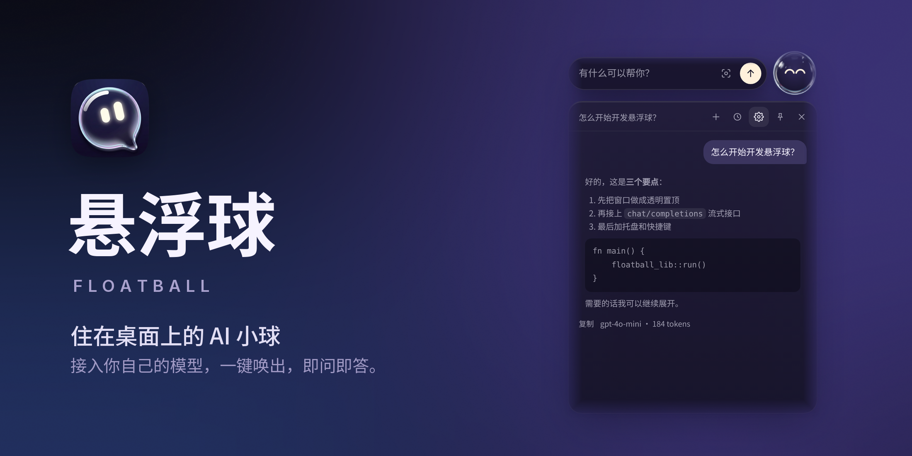
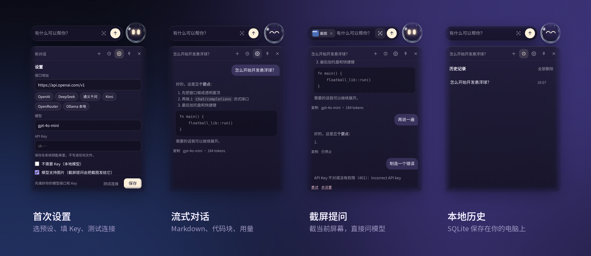

<div align="center">



<br>

**一颗住在桌面上的玻璃小球。轻点展开，问完即收。<br>接入你自己的模型，数据只留在你的电脑上。**

<br>


[功能](#功能) · [安装](#安装) · [接入模型](#接入模型) · [快捷键](#快捷键) · [隐私](#隐私与数据) · [路线图](#路线图) · [开发](#从源码构建) · [许可证](#许可证)

</div>

<br>

## 为什么是一颗球

大多数 AI 工具要你切到另一个窗口、另一个标签页。悬浮球反过来：它安静地待在屏幕边上，你需要时它就在手边。

- **不打断。** 一个快捷键唤出，`Esc` 收起，小球回到原处。
- **看得懂。** 它会眨眼、好奇、思考、工作、完成时眯眼笑。你一眼就知道它在干什么。
- **不绑定。** 任何 OpenAI 兼容接口都能用，云端或本地 Ollama，模型和费用由你决定。
- **轻。** 基于 Tauri 2 与系统 WebView，不捆绑浏览器内核。

<br>



## 功能

| 能力 | 说明 |
|---|---|
| **常驻桌面** | 透明、无边框、始终置顶，不占任务栏与 Dock。拖动即走，靠边自动吸附，重启后回到原位。 |
| **会看方向** | 小球在屏幕哪一侧，就朝另一侧展开，永远不会跑出屏幕。 |
| **流式对话** | 逐字输出，可随时停止、重试、复制。支持 Markdown 与代码块，推理模型的思考过程单独显示，显示 token 用量。 |
| **截屏提问** | 一键截取当前屏幕（截图前自动藏起小球），直接发给支持图像的模型。 |
| **拖入文件** | 把代码、Markdown、文本、CSV 拖到小球上，内容即成为上下文。 |
| **本地历史** | 对话保存在本机 SQLite，可逐条或全部删除。 |
| **系统级集成** | 菜单栏 / 托盘、原生右键菜单、全局快捷键、开机启动、单实例。 |

## 安装

> v0.1 为预览版，尚未经过 Apple 公证与 Windows 代码签名，首次打开系统会拦截一次。

从 [Releases](../../releases) 或 [Actions](../../actions) 的构建产物下载：

| 平台 | 文件 | 首次打开 |
|---|---|---|
| macOS（Apple 芯片） | `悬浮球_x.y.z_aarch64.dmg` | 拖入「应用程序」后打开一次，被拦截时前往 **系统设置 → 隐私与安全性**，点 **仍要打开**。若提示「已损坏」，执行 `xattr -cr /Applications/悬浮球.app` |
| Windows 10 / 11 | `悬浮球_x.y.z_x64-setup.exe` | SmartScreen 提示时点 **更多信息 → 仍要运行** |

在 macOS 上首次使用截屏提问，需要在 **系统设置 → 隐私与安全性 → 屏幕与系统录音** 中允许悬浮球，然后重启应用。

## 接入模型

首次启动会自动打开设置。选一个预设，填入 API Key，点「测试连接」，保存即可。

| 预设 | 接口地址 | 默认模型 |
|---|---|---|
| OpenAI | `https://api.openai.com/v1` | `gpt-4o-mini` |
| DeepSeek | `https://api.deepseek.com/v1` | `deepseek-chat` |
| 通义千问 | `https://dashscope.aliyuncs.com/compatible-mode/v1` | `qwen-plus` |
| Kimi | `https://api.moonshot.cn/v1` | `moonshot-v1-8k` |
| OpenRouter | `https://openrouter.ai/api/v1` | `openai/gpt-4o-mini` |
| Ollama（本地） | `http://localhost:11434/v1` | `qwen2.5:7b`，无需 Key |

其他服务只要提供 `/chat/completions` 兼容接口，填入地址与模型名即可。

## 快捷键

| 操作 | macOS | Windows |
|---|---|---|
| 呼出 / 收起 | `⌥ Space` | `Alt + Space` |
| 截屏提问 | `⌥ ⇧ S` | `Alt + Shift + S` |
| 发送 | `↩` | `Enter` |
| 换行 | `⇧ ↩` | `Shift + Enter` |
| 收起 | `Esc` | `Esc` |

全局快捷键可在设置中修改；与其他应用冲突时会提示。

## 隐私与数据

- **API Key** 存于系统钥匙串（macOS 钥匙串 / Windows 凭据管理器），不写入任何文件。
- **对话与设置** 只保存在本机，没有任何服务器，没有遥测。
- **请求** 只发往你填写的那个模型接口。

| 数据 | macOS | Windows |
|---|---|---|
| 设置 | `~/Library/Application Support/com.floatball.app/` | `%APPDATA%\com.floatball.app\` |
| 历史 | 同上 `history.db` | `%LOCALAPPDATA%\com.floatball.app\history.db` |

## 路线图

- [x] 常驻小球、拖动吸附、表情状态
- [x] OpenAI 兼容流式对话、多服务预设
- [x] 截屏提问、拖入文本文件、本地历史
- [x] 托盘、右键菜单、全局快捷键、开机启动
- [ ] 系统原生毛玻璃材质（macOS Liquid Glass / Windows Mica）
- [ ] 小球到胶囊的连续变形动画
- [ ] 划词操作、语音输入
- [ ] Agent：工具调用与逐步审批、步数与预算上限
- [ ] 技能库、定时任务、多 Agent 协作
- [ ] PDF 与图片附件、自动更新
- [ ] Apple 公证与 Windows 代码签名

## 从源码构建

**环境**

- macOS：Xcode 命令行工具（`xcode-select --install`）、[Rust](https://rustup.rs)、[Node.js](https://nodejs.org) LTS
- Windows：[Visual Studio Build Tools](https://visualstudio.microsoft.com/visual-cpp-build-tools/)（勾选「使用 C++ 的桌面开发」）、[Rust](https://rustup.rs)、[Node.js](https://nodejs.org) LTS；WebView2 在 Windows 10/11 上通常已预装

**运行与打包**

```bash
npm install
npm run dev      # 开发运行，首次编译需要几分钟
npm run build    # 生成 .dmg / 安装程序
```

不想装 Node 也可以：前端是纯 HTML/CSS/JS，`cd src-tauri && cargo run` 即可运行。

**云端构建**：仓库自带 GitHub Actions 工作流。在 **Actions → 构建安装包 → Run workflow** 手动触发，或推送 `v*` 标签，即可同时得到 macOS 与 Windows 安装包。

**测试**

```bash
cd src-tauri && cargo test           # 流式解析、HTTP、历史、设置、截图编码
python3 tools/test_ui.py ./ui-shots  # 界面测试（需 Playwright）
```

工程结构、实现细节与验证记录见 [开发文档](docs/DEVELOPMENT.md)。

## 技术栈

[Tauri 2](https://tauri.app) · Rust · 原生 HTML / CSS / JS（零构建步骤）· SQLite · 系统钥匙串 · [xcap](https://github.com/nashaofu/xcap) 截屏

## 许可证

[MIT](LICENSE) © 2026 Feli999ovo

## 已知限制

- 小球与卡片的玻璃效果目前由界面绘制，尚不会透出背后的桌面内容；系统原生材质在路线图中。
- v0.1 在 Linux 上完成编译、自动化测试与端到端验证，尚待更多 macOS 与 Windows 真机反馈。欢迎提交 [Issue](../../issues)，附上系统版本与终端输出。

<br>

<div align="center">
<sub>为桌面而做 · Made with Tauri</sub>
</div>
